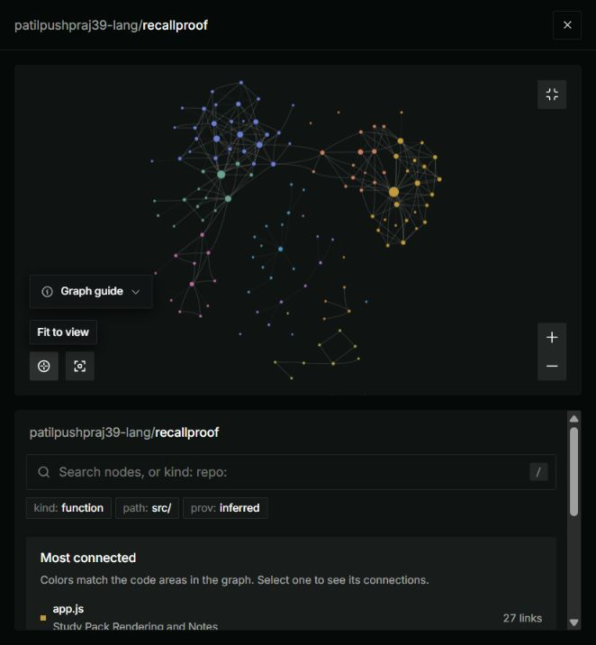

# RecallProof

Answer, inspect the evidence, and retry: a small revision coach powered by **Gemma 4**.

**[Live demo](https://recallproof.vercel.app/)** · **[Graphify graph](https://app.graphify.com/recallproof/graph?repo=recallproof)** · **[Graph showcase](#graphify)**

The demo page is public; AI requests require the presenter code, shared privately with intended demo users. The Google API key stays on the server.

Students can get plausible answers from AI without noticing that the explanation goes beyond their notes. RecallProof divides notes into numbered source passages. Gemma chooses source IDs for each generated summary point and answer; the backend validates those IDs and retrieves the original text itself. Items with missing or invalid references are withheld, and students can highlight the original passages.

The practice flow asks students to write an answer and choose whether they feel sure or unsure before revealing a suggestion. Gemma gives notes-based feedback; the student can inspect the original passages, retry the question, and filter to cards flagged for review. A felt-sure answer that receives conflicting or partial feedback gets a review-priority note. This is a prompt for human review, not a verified diagnosis of misunderstanding.

**Important limitation:** an existing source reference does not prove that it supports the associated claim. The model can select the wrong passage, misinterpret a genuine one, or give incorrect feedback on a student's answer. Feedback is labelled as AI feedback, not an objective grade. RecallProof validates reference existence and retrieves original source text, not factual or semantic correctness; it cannot determine whether the source notes themselves are correct.

## Run locally on Windows

Requires Node.js 22 or later and a Google AI Studio API key with access to `gemma-4-26b-a4b-it`. No npm dependencies are required.

Open a PowerShell terminal in this folder, then run:

```powershell
npm start
```

Paste your key into the hidden terminal prompt once, then press Enter. Open **http://127.0.0.1:4173**. Use **Try sample notes**, then **Create my study pack**. Press Ctrl+C in the terminal to stop.

The key is kept in server memory and is not sent to the browser or saved by this app. Alternatively, the launcher reads `GEMINI_API_KEY` from its process environment. Never commit a key or paste one into a screenshot or GitHub issue.

Notes and submitted answers are sent to Google's hosted Gemini API to run Gemma. This is an online API prototype, not offline inference. Notes, generated packs, confidence choices and attempts are not saved to disk by the application. Practice progress exists in browser memory until the page is refreshed or notes change. Google's service has its own terms and data handling policies.

## What it does

1. Accepts up to 12,000 characters of factual study notes.
2. Divides notes into numbered passages and asks Gemma for up to three summary points and three distinct recall questions with answers and source IDs.
3. Validates the source IDs on the backend, retrieves the original passages, and withholds items with invalid references. Comparisons can reference up to three passages.
4. Lets students think before revealing an answer and inspect its highlighted source passage.
5. Reviews typed answers with Gemma using five possible feedback labels: supported, partial, conflicting, not covered, or uncertain. Missing evidence references withhold the feedback.
6. Keeps an in-session review queue, supports retries and records whether a suggested answer was revealed before an attempt. Progress counts attempts and review flags; it is not an accuracy or learning-gain score.

Short notes may produce fewer items. Empty input, API errors, quota limits and incomplete responses receive visible messages. There are no automatic retries that silently consume more quota.

## Architecture

```text
Browser: public/app.js
    POST /api/study (notes only)
Node backend: server.mjs
    validateNotes -> generateStudyPack -> verifyStudyPack
Gemma: lib/gemma.mjs -> Google's generateContent endpoint
Evidence checks: lib/evidence.mjs -> numbered passages + reference validation + original source positions
Browser: summary, reveal cards, highlighted passages

Browser practice: public/practice.mjs + public/session.mjs
    POST /api/review (notes, question, student answer, confidence)
Review validation: lib/review.mjs
    validateReviewInput -> buildReviewPrompt -> requestGemmaJson
    verifyReview -> resolveSources -> original passages
Browser: AI feedback -> priority note -> retry -> review queue
```

The local launcher binds to loopback only. The backend rejects foreign browser origins and unexpected hostnames, serves only explicitly listed public assets, and never exposes raw provider error responses. The hosted adapter additionally requires a presenter code for model requests. This prototype has no user accounts, durable storage or distributed quota enforcement. See [DEPLOYMENT.md](DEPLOYMENT.md) for the hosting setup and its limits.

## Tests

```powershell
npm test
```

Automated tests use synthetic data and mocked model responses. They cover invalid source IDs, source retrieval, Windows line endings, the semantic limitation, feedback validation, retries, assisted attempts, session isolation, invalid inputs, credential redaction, upstream failures, local HTTP handling and overlapping requests. The test command explicitly selects the current test files, excluding ignored development backups. Tests do **not** establish real model quality or live end-to-end generation. See [VALIDATION.md](VALIDATION.md) for observed results and pending checks.

## Graphify

**[Explore the interactive Graphify graph](https://app.graphify.com/recallproof/graph?repo=recallproof)**



The latest completed index observed on **October 22, 2026** reported **132 nodes and 281 edges**: 279 extracted, 2 inferred, 0 synthesized and 0 observed. [View the captured totals](docs/graphify-totals.png). These are snapshot counts from Graphify, not a judging score; later indexing can change them. The indexed commit was not shown in these captures.

### What to show judges

1. Open the graph and fit it to view to introduce the connected code areas.
2. Select `app.js` to explain the study-pack interface and practice flow. The captured graph lists 27 links for this node.
3. Search for `verifyStudyPack()` in `lib/evidence.mjs`. Show its connections to `buildSourcePassages()`, `resolveSources()`, the server and genuine tests. This is where source IDs are checked and original passages are retrieved; it does not prove that an AI claim is semantically correct.
4. Select `server.mjs` to connect the interface to validation and model requests, then return to the live app and demonstrate a source highlight.

The screenshots keep the graph visible in this public repository even if an interactive viewer needs Graphify access. `.graphifyignore` scopes local extraction to application and genuine test code, excluding backups and generated output; hosted indexing can use different coverage. Follow the organizer's instructions for eligible graph scope and submission.

Windows Application Control blocked the local `graphify.exe` launcher. The hosted workflow succeeded without changing that security policy.

## Reliability and session report

Version 0.3 retains a completed pack, checked attempts and drafts if regenerating the same notes fails. Editing notes intentionally clears the current session. Correcting the final flagged card restores all cards rather than leaving a stale filtered view. Provider errors include the numeric HTTP status without exposing raw diagnostics, keys or notes; there are no automatic model retries.

Use **Download session (.txt)** to explicitly save notes, summaries, suggested answers, source passages and the latest ten checked attempts per question as plain text. Unsubmitted drafts are excluded. The report labels model feedback and assistance; it is not an objective grade or evidence of independent mastery. Download generation happens in the browser and makes no extra model request. This is a readable report, not an importable backup; refreshing the page still clears session memory. Keep any report containing private notes private. The key is not included in the report.

## Ask your notes

After generating a pack, scroll below the cards to ask another question about the same notes. Each submission makes one request to Gemma using the shared private backend client. It receives numbered passages and a question supplied as data. The backend retrieves original text for valid source IDs, withholds answers with invalid references, and substitutes the fixed response **Not covered in these notes.** when the model reports that the notes do not answer the question. The coverage decision and meaning of an answer still depend on the model; this is not guaranteed hallucination prevention or proven prompt-injection resistance.

Notes questions may cite up to six original passages; short generated items and practice feedback keep their three-reference limit. Withheld question answers distinguish missing source lists, excessive reference counts and unknown or malformed IDs. The prompt asks for focused answers with supporting passages selected for every claim. This does not semantically verify coverage or guarantee that a later model answer will pass.

This feature provides study help and may reveal card answers. Later practice attempts disclose prior use of the notes assistant. The latest five responses are retained in browser memory and included in the text report, including not-covered and withheld outcomes. The questions, like notes and submitted answers, are sent to Google's hosted API. There is no automatic persistence, new dependency, extra service or automatic retry.

Implementation: `POST /api/ask` in `server.mjs` -> `validateQuestionInput` -> `buildQuestionPrompt` -> shared `requestGemmaJson` -> `verifyNoteAnswer` -> original sources. `public/ask.mjs` renders the result, and `public/session.mjs` tracks the assistance context. Participant-run screenshots show one correct list/tuple comparison with a citation-coverage gap and one correct not-covered outcome for a Python creator/year question absent from the notes. These examples do not establish general accuracy; see `VALIDATION.md`.

## Model, dependencies and assistance

- Model: [`gemma-4-26b-a4b-it`](https://ai.google.dev/gemma/docs/core/gemma_on_gemini_api), hosted through Google's Gemini API.
- Model usage is governed by the applicable [Gemma terms](https://ai.google.dev/gemma/terms), separate from this application's MIT license.
- Runtime: Node.js standard library, browser HTML/CSS/JavaScript. No npm dependencies.
- AI assistance: OpenAI Codex generated the initial application, styling, tests and documentation and assisted with debugging. The participant supplies the problem selection, local execution, testing feedback and demonstration; independent understanding must be demonstrated, not assumed.
- Development began after the participant reported the event's coding start on October 22, 2026. The earlier two-file Graphify practice is not included.

## License

Application code: MIT. See [LICENSE](LICENSE). Public source: https://github.com/patilpushpraj39-lang/recallproof . Publishing the repository does not complete the event submission.
